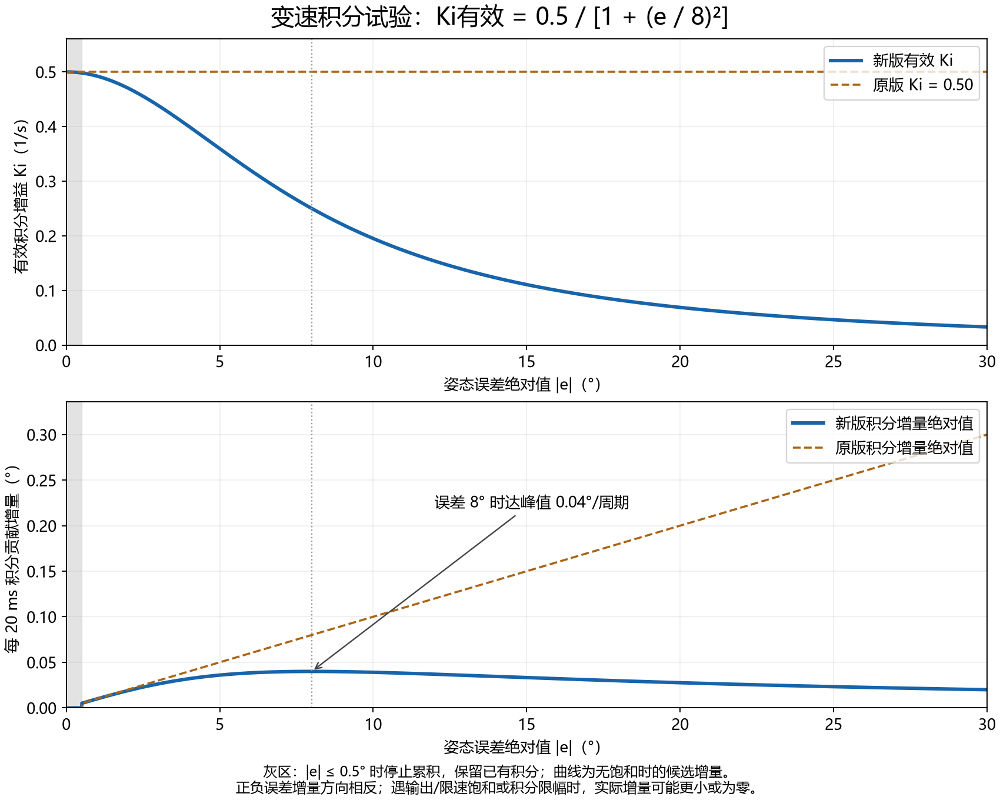

# 纯比例稳定后恢复小力度积分

版本`v0.6.5-pi05-no-d-test`。用户确认纯比例版水平静止不摆，受扰后也不摆，但有约5.9°残余误差；同意保留Kp1/Kd0，恢复峰值Ki0.5的变速积分。

## 唯一固件参数变化

APP_HOLD_NORMAL_KI从0改0.5，Kp1.0、Kd0、尺度8°、死区0.5°、限速180°/s和保护不变。

```text
Ki_eff = 0.5 / [1 + (e / 8)^2]
候选ΔI = Ki_eff * e * dt
```

小于等于0.5°死区仍不累积、已有补偿保留。误差5°时Ki_eff约0.360，每20ms候选积分增量约0.036°；误差1°时约0.00985°。遇饱和/积分限幅时实际增量可能减小或停止。目标是恢复积分消除残差且不摆，不宣称已解决缓慢抽动。



## 主机检查

control和app_integration通过，新增应用持续偏差时积分实际改变输出且保持在输出范围内的检查。非线性函数测试仍使用非零参数，既有保护继续检查。

同一8°模型、两者Kd均0：Kp0.8/恒定Ki0.5对照达标6400ms，本版Kp1/变速积分峰值0.5为7060ms，均包含1秒达标确认。不是实物预测。本版不满足“比不同配置更快”的旧测试断言，因此该断言改为20秒内有界误差消除检查；这反映本轮先恢复积分并验证稳定性的目标变化，不作为提速通过结论。旧版完整测试仍在原标签。

## 用户验收

1. 用户在Keil Rebuild并下载，底座水平、IMU随连杆固定，等静止校准。
2. 开HOLD、目标约90°，手离开静置20秒。先反馈是否重新出现持续左右摆动。
3. 静止正常后再录CSV：开始时水平静置2秒，用固定小支撑将底座倾斜约5°；放好松手后不碰机构，不在末尾放回水平，继续记录30秒，另存trace_pi05_nod.csv。
4. 观察残差是否逐渐减小、到位后是否摆动。出现持续摆动则关闭HOLD，保留记录；若IMU_INVALID，查询首次故障记录，不能把故障停机当稳定。

本项待实物验收，助手未编译或烧录MCU，IMU_INVALID未解决。备份backups/v0.6.5-pi05-no-d-test.zip；纯比例对照保留标签v0.6.4-p-only-diagnostic。
